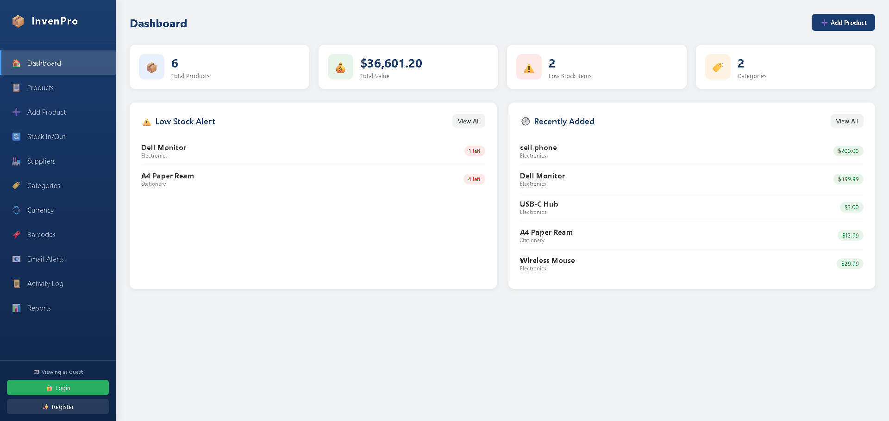
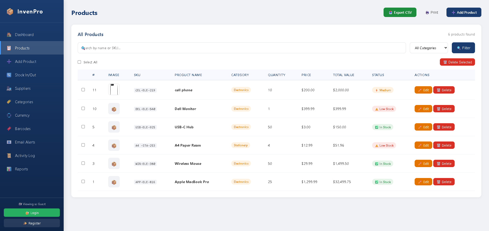
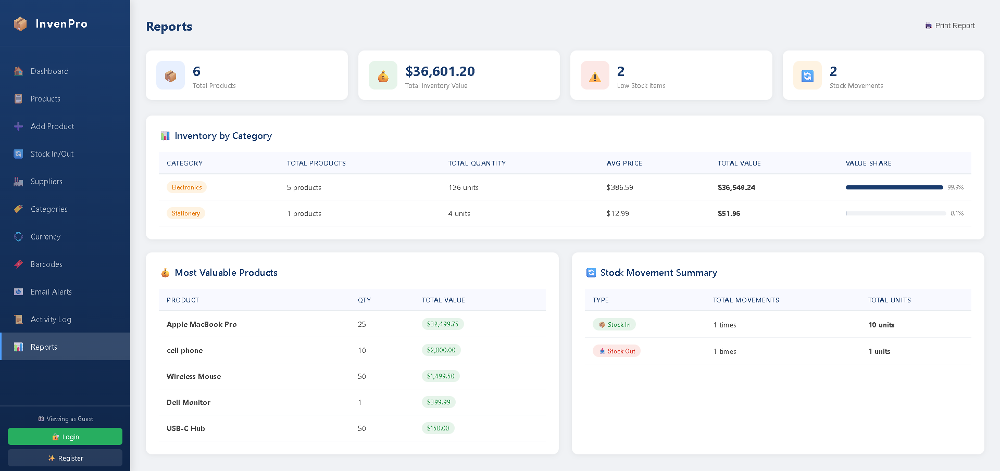
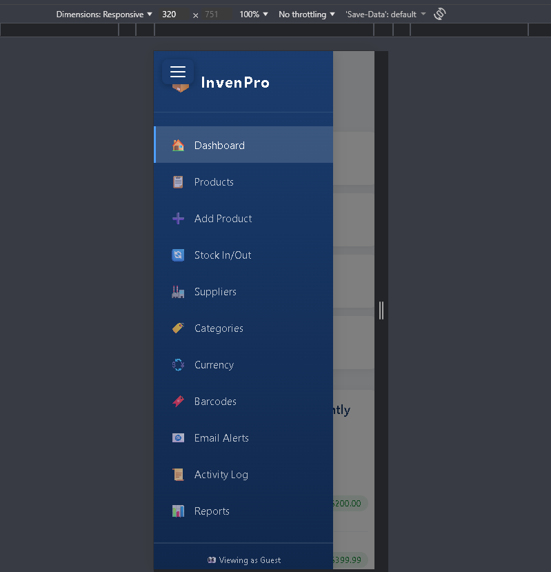

# 📦 InvenPro — Professional Inventory Management System


A fully-featured, professional Inventory Management System built with pure PHP, MySQL, HTML, and CSS — no frameworks. Designed to demonstrate real-world web development skills including authentication, API integration, responsive design, and business logic.

---

## 🌟 Live Demo

> Guest Access: Visit any page without login to browse
> Admin Access: Register an account to unlock full features

---

## ✨ Features

### 🔐 Authentication
- User Registration & Login
- Session-based authentication
- Guest mode — browse without login
- Role-based access control
- Secure password hashing (bcrypt)

### 📦 Product Management
- Add, Edit, Delete products
- SKU auto-generation system
- Product image upload
- Category management
- Supplier linking

### 📊 Dashboard & Analytics
- Real-time stats cards (Total Products, Total Value, Low Stock, Categories)
- Low stock alerts panel
- Recently added products panel

### 🔄 Stock Management
- Stock In / Stock Out tracking
- Stock movement history
- Automatic quantity updates
- Low stock warnings (≤5 units)

### 🏭 Supplier Management
- Add and manage suppliers
- Link products to suppliers
- Track supplier contact info

### 🏷️ Category Management
- Add, Edit, Delete categories
- Product count per category
- Protected deletion (can't delete if products exist)

### 📋 Reports
- Inventory by category with value share bars
- Most valuable products
- Most/least stocked products
- Stock movement summary

### 🔍 Search & Filter
- Search by product name or SKU
- Filter by category
- Real-time results

### 📥 Export & Print
- Export to CSV
- Print-friendly layout
- Bulk delete products

### 📄 Pagination
- 10 products per page
- Dynamic page navigation

### 🌐 API Integrations
- **ExchangeRate API** — Real-time currency conversion (USD to PKR, EUR, GBP, AED, SAR, and more)
- **Barcode API** — Auto-generated barcodes for every product SKU (downloadable + printable)
- **Gmail SMTP (PHPMailer)** — Automated low stock alert emails

### 📱 Responsive Design
- Mobile-friendly hamburger menu
- Tablet and desktop optimized
- Print stylesheet included

### 📜 Activity Log
- Tracks every user action
- Timestamps for all events
- Clearable log history

---

## 🛠️ Tech Stack

| Technology | Usage |
|------------|-------|
| PHP 8.2 | Backend logic, sessions, file handling |
| MySQL | Database (mysqli with prepared statements) |
| HTML5 | Structure and markup |
| CSS3 | Custom styling, responsive design, animations |
| PHPMailer | Email alerts via Gmail SMTP |
| ExchangeRate API | Live currency conversion |
| Barcode API | Product barcode generation |
| Composer | PHP dependency management |

---

## 🔒 Security Features

- Prepared statements (SQL injection prevention)
- Password hashing with `password_hash()` (bcrypt)
- Session-based authentication
- XSS prevention with `htmlspecialchars()`
- File upload validation (type + size)
- CSRF-safe form handling
- Input sanitization on all forms

---

## 📁 Project Structure
```
inventory-system/
├── auth.php              # Session authentication guard
├── dashboard.php         # Main dashboard with stats
├── products.php          # Product listing, search, filter, export
├── add.php               # Add new product with image upload
├── edit.php              # Edit existing product
├── delete.php            # Delete product
├── stock.php             # Stock In/Out management
├── suppliers.php         # Supplier management
├── categories.php        # Category management
├── currency.php          # Currency conversion (API)
├── barcode.php           # Barcode generator (API)
├── email_alerts.php      # Low stock email alerts (API)
├── reports.php           # Inventory reports
├── activity.php          # Activity log
├── login.php             # User login
├── register.php          # User registration
├── logout.php            # Session logout
├── sidebar.php           # Shared navigation component
├── style.css             # Complete stylesheet
├── db.php                # Database connection (excluded from repo)
└── uploads/              # Product images (excluded from repo)
```

---

## ⚙️ Installation & Setup

### Prerequisites
- XAMPP (Apache + MySQL + PHP 8.x)
- Composer
- Gmail account with App Password (for email alerts)

### Steps

**1. Clone the repository**
```bash
git clone https://github.com/sn123686-dev/inventory-system.git
cd inventory-system
```

**2. Install dependencies**
```bash
composer install
```

**3. Create the database**

Open phpMyAdmin and run:
```sql
CREATE DATABASE inventory_db;
USE inventory_db;

CREATE TABLE products (
    id INT AUTO_INCREMENT PRIMARY KEY,
    name VARCHAR(100) NOT NULL,
    sku VARCHAR(50) UNIQUE,
    category VARCHAR(100) NOT NULL,
    supplier_id INT NULL,
    quantity INT NOT NULL,
    price DECIMAL(10,2) NOT NULL,
    image VARCHAR(255) NULL,
    created_at TIMESTAMP DEFAULT CURRENT_TIMESTAMP
);

CREATE TABLE categories (
    id INT AUTO_INCREMENT PRIMARY KEY,
    name VARCHAR(100) NOT NULL UNIQUE,
    created_at TIMESTAMP DEFAULT CURRENT_TIMESTAMP
);

CREATE TABLE suppliers (
    id INT AUTO_INCREMENT PRIMARY KEY,
    name VARCHAR(100) NOT NULL,
    email VARCHAR(100),
    phone VARCHAR(20),
    address TEXT,
    created_at TIMESTAMP DEFAULT CURRENT_TIMESTAMP
);

CREATE TABLE stock_movements (
    id INT AUTO_INCREMENT PRIMARY KEY,
    product_id INT NOT NULL,
    type ENUM('in', 'out') NOT NULL,
    quantity INT NOT NULL,
    note VARCHAR(255),
    created_at TIMESTAMP DEFAULT CURRENT_TIMESTAMP,
    FOREIGN KEY (product_id) REFERENCES products(id) ON DELETE CASCADE
);

CREATE TABLE activity_log (
    id INT AUTO_INCREMENT PRIMARY KEY,
    action VARCHAR(255) NOT NULL,
    created_at TIMESTAMP DEFAULT CURRENT_TIMESTAMP
);

CREATE TABLE users (
    id INT AUTO_INCREMENT PRIMARY KEY,
    name VARCHAR(100) NOT NULL,
    email VARCHAR(100) NOT NULL UNIQUE,
    password VARCHAR(255) NOT NULL,
    role ENUM('admin', 'user') DEFAULT 'user',
    created_at TIMESTAMP DEFAULT CURRENT_TIMESTAMP
);
```

**4. Create db.php**

Create a file called `db.php` in the project root:
```php
<?php
$host     = "localhost";
$username = "root";
$password = "";
$database = "inventory_db";

$conn = mysqli_connect($host, $username, $password, $database);

if (!$conn) {
    die("Connection failed: " . mysqli_connect_error());
}
?>
```

**5. Create uploads folder**
```bash
mkdir uploads
```

**6. Run on localhost**

Place the project in `C:\xampp\htdocs\inventory-system\` and visit:
```
http://localhost/inventory-system/login.php
```

---

## 🌐 API Setup

### Currency Conversion
- Sign up free at [exchangerate-api.com](https://www.exchangerate-api.com)
- Get your API key
- Add it to `currency.php`

### Barcode Generator
- No setup needed — uses [barcodeapi.org](https://barcodeapi.org) (free, no key required)

### Email Alerts (Gmail SMTP)
- Enable 2-Step Verification on your Gmail
- Go to Google Account → Security → App Passwords
- Create an App Password
- Enter it in the Email Alerts page when sending

---

## 📸 Screenshots

### Dashboard


### Products


### Reports


### Mobile View


---

## 👩‍💻 Author

**Saima Nadeem**
- GitHub: [@sn123686-dev](https://github.com/sn123686-dev)
- Location: Islamabad, Pakistan

---

## 📄 License

This project is open source and available under the [MIT License](LICENSE).